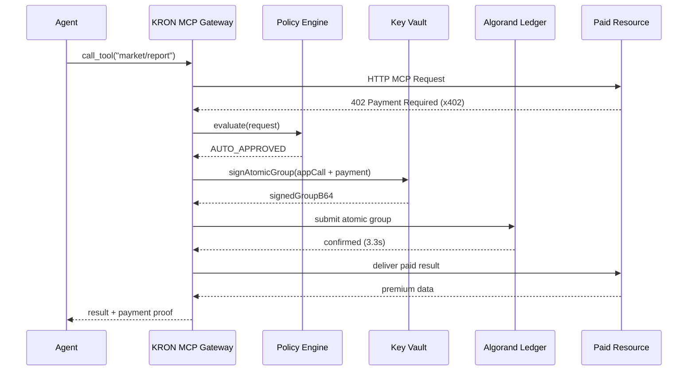
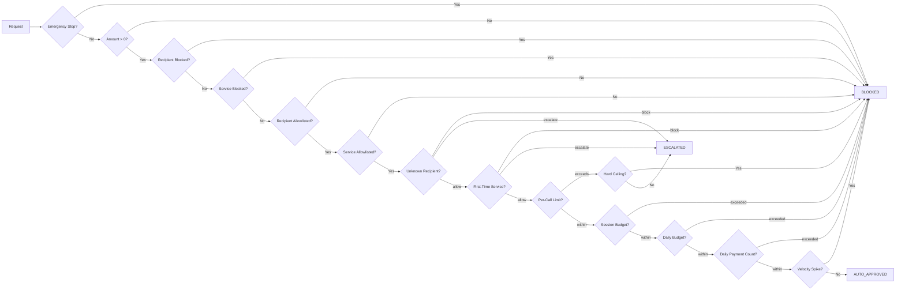
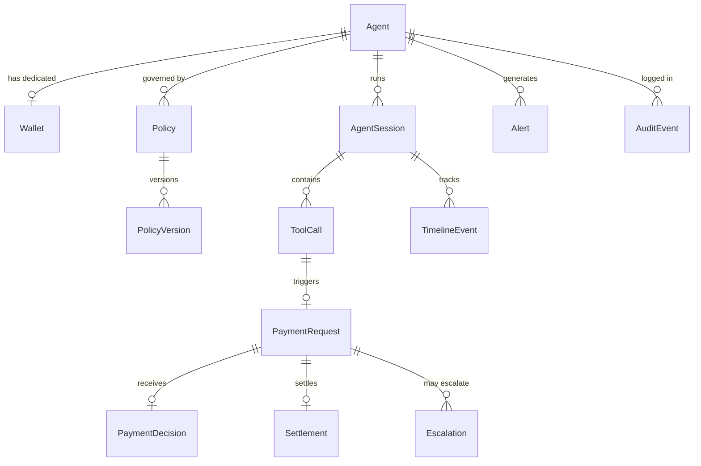

# KRON Architecture

## System Overview

```
┌─────────────────────────────────────────────────────────────────────┐
│                        Autonomous AI Agent                          │
│              (LangChain / LlamaIndex / MCP Client)                  │
└──────────────────────────────┬──────────────────────────────────────┘
                                │ MCP Tool Request
                                ▼
┌─────────────────────────────────────────────────────────────────────┐
│                      KRON MCP Gateway                               │
│  ┌─────────────────────────────┐   ┌─────────────────────────────┐  │
│  │   x402 402 Interceptor      │──▶│   Policy Engine (<5ms)      │  │
│  └─────────────────────────────┘   └─────────────┬───────────────┘  │
│                                                  │                  │
│                                   AUTO_APPROVED / ESCALATED / BLOCKED│
│                                                  │                  │
│  ┌─────────────────────────────┐                ▼                  │
│  │ Isolated Key Vault          │──▶ Sign Atomic Transaction Group   │  │
│  │ (AES-256-GCM)               │    [App Call + Payment Tx]        │  │
│  └─────────────────────────────┘                                    │
└──────────────┬──────────────────────────────┬───────────────────────┘
               │                              │
     Real-Time SSE Events             3.3s Finality
               │                              │
               ▼                              ▼
┌──────────────────────────────┐ ┌──────────────────────────────────┐
│      Operator Console        │ │      Algorand Ledger             │
│  ┌────────────────────────┐  │ │  ┌────────────────────────────┐  │
│  │ Live Payments Feed     │  │ │  │ App Call (Policy Hash)    │  │
│  │ Policy What-If Sim     │  │ │  │ Payment (microAlgos)      │  │
│  │ On-Chain Verifier      │  │ │  │ ARC-2 Note (kron:j{...})  │  │
│  │ Fleet Emergency Stop   │  │ │  │ Atomic Group (both or     │  │
│  │ Audit Log              │  │ │  │ neither)                  │  │
│  └────────────────────────┘  │ │  └────────────────────────────┘  │
└──────────────────────────────┘ └──────────────────────────────────┘
```

## Data Flow: Autonomous Payment



## Policy Engine Rule Pipeline



## Traceability Chain



## Package Layout

| Package | Responsibility |
|---|---|
| `@kron/shared` | Types, DTOs, constants, protocol helpers |
| `@kron/policy-engine` | Deterministic <5ms rule evaluation + simulation |
| `@kron/x402` | ARC-2 notes, TEAL contract, atomic groups, verification |
| `@kron/sdk` | TypeScript SDK for agent developers |
| `@kron/api` | Fastify REST API, MCP gateway, SSE hub |
| `@kron/dashboard` | React + Tailwind operator console |
| `@kron/resource-server` | Paid MCP tools with x402 gating |
| `@kron/demo-agent` | Autonomous agent driving live demos |

## Why Algorand?

| Feature | Benefit for AI Agents |
|---|---|
| **3.3s Finality** | Agents cannot stall waiting for block confirmation |
| **Sub-cent Fees** | High-frequency micro-transactions viable |
| **Atomic Groups** | Policy anchor + payment succeed or fail together |
| **ARC-2 Notes** | Standardized metadata embedded on-chain |
| **Smart Contracts** | On-chain policy anchoring and auditability |
